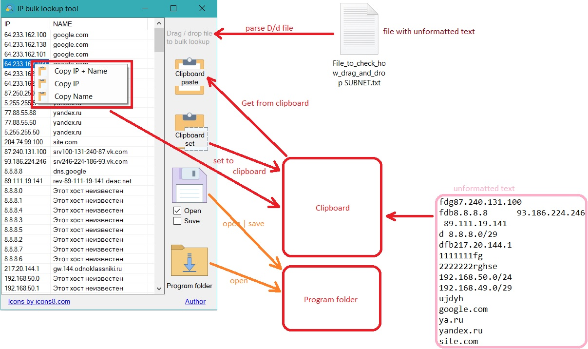

# Fast bulk ip lookup tool

## Description ENG

1. Drag and drop file or get from clipboard list of IP adresses or DNS names
2. Save resault with DNS/server names to file or clipboard
3. Automatic ICMP ping check with live status for every host

## Descriptions RU

### Основной функционал

1. Определение неограниченного количества IP-адресов по неограниченному количеству DNS-имен;
2. Определение неограниченного количества DNS-имен по неограниченному количеству IP-адресов;
3. Поддержка быстрого вычисления DNS-имён для сети в CIDR-формате A.B.C.D/маска — маски от **/20 до /32** (ранее только /24 и крупнее), адреса сети вычисляются корректно для любых маски и стартового адреса.

### Проверка доступности хостов (ping)

1. Для каждого найденного адреса автоматически выполняется ICMP ping
2. Колонка статуса 🌐 в таблице: ✔ — хост отвечает, ⚠ — DNS запись есть, но хост не пингуется, 🚫 — недоступен и DNS-записи нет

### Не основной функционал

1. Поддержка входных данных в неструктурированном формате
2. Получение входных данных из буфера обмена
3. Получение выодных данных из файла
4. Получение входных данных путём перетягивания файла на форму (drug and drop)
5. Экспорт данных в CSV в один клик
6. Сохранение истории выполнения программы в виде CSV файлов

### Удобство интерфейса

1. Автоподгон ширины колонок: колонка IP подстраивается под содержимое (не шире максимального адреса 255.255.255.255), колонка NAME занимает всю оставшуюся ширину таблицы;
2. Боковая панель инструментов зафиксирована слева, таблица растягивается при изменении размера окна;
3. Поддержка высокого DPI (PerMonitorV2) и корректный запуск на Windows 10/11.

## Требования и установка

Приложение перенесено на **.NET 10** (Windows Forms):

- вариант 1 — автономный (`self-contained`) exe ~52 МБ, не требует установленного .NET (сборка Release, `win-x64`)
- вариант 2 — компактная сборка, требует установленный .NET 10 Desktop Runtime

Минимальная ОС: Windows 10 1607 / Windows 11.

## Screenshot

